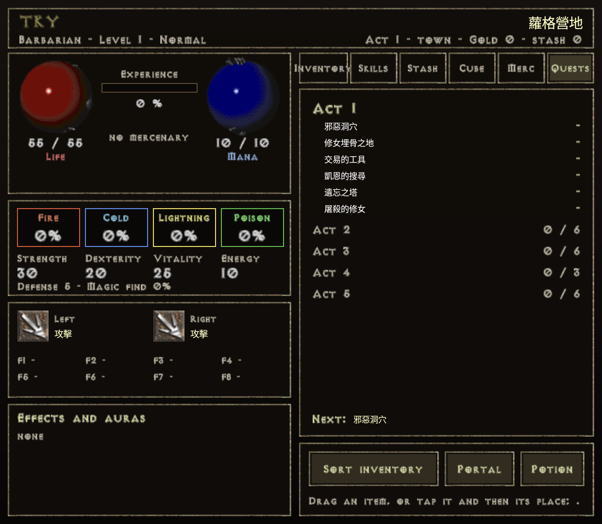
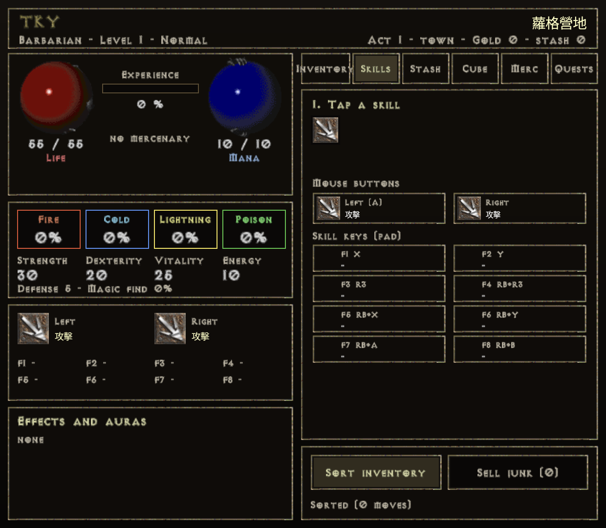
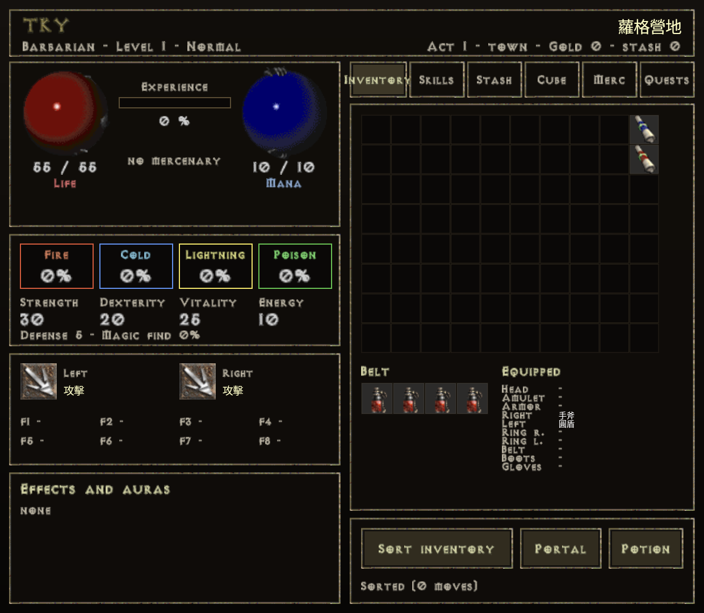
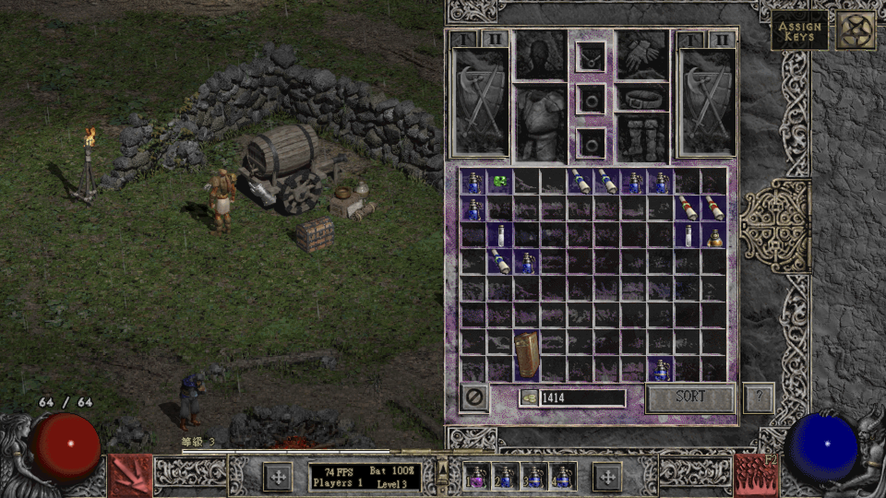
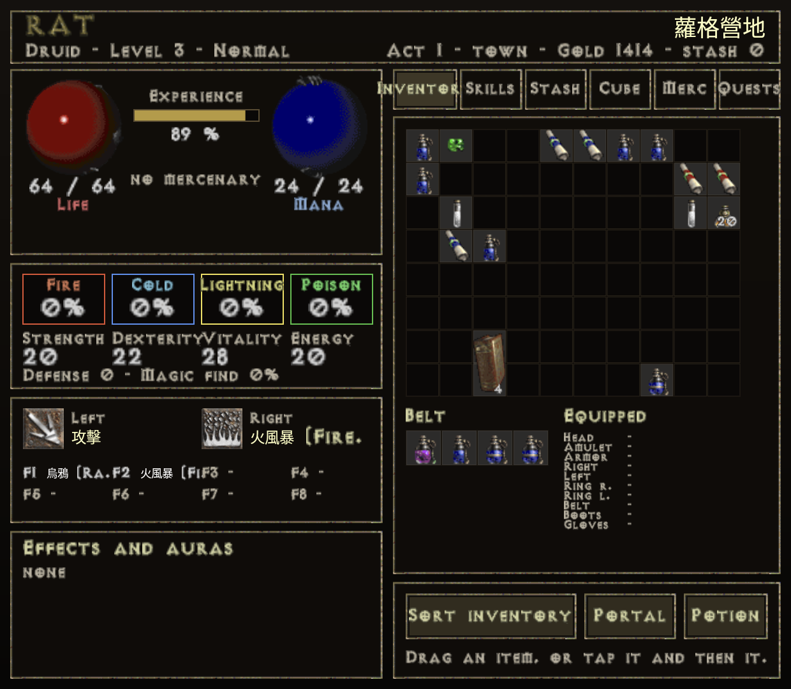

# Thor D2

**Diablo II: Lord of Destruction 1.13d on the AYN Thor, with a live deck on the second screen.**

Thor D2 is a fork of [D2Android](https://github.com/N1v0k/D2Android-Releases) 1.5.2 for dual-screen Android
handhelds such as the AYN Thor. The game runs on the upper screen as a clean picture without touch buttons; the
lower screen shows a deck with your character, items, skills and quests, live from the game.

> **📌 About this fork (`cjk-biginv` branch, based on `cjk-font-support`):** this fork adds **Chinese (CJK) text support
> to the deck** and enables the **10×8 big inventory for Chinese games**.
> Stock Thor D2 can only draw Latin characters on the lower screen — with a Chinese game, quest/skill/item/area names
> show up as `?`. Here Latin text keeps the original game font and Chinese falls back to the system CJK font.
> Stock Thor D2 also refuses the big inventory in Chinese, because its list of "languages with their own inventory
> picture" lumps Chinese in with Japanese and Korean; the Chinese panel is in fact identical to the English one, so
> this branch lets Chinese (simplified and traditional) use the 10×8 grid as well.
> This is a community modification, **not** an official upstream release. See
> [Changes in this branch](#changes-in-this-branch-cjk-font-support) below for details and screenshots.

If it works for you, a ⭐ on GitHub helps – and [subscribing on YouTube](https://www.youtube.com/@toravomusic?sub_confirmation=1) helps me bring more ports to the Thor.

> Unofficial fan project, **not affiliated with, endorsed or supported by Blizzard Entertainment**. Diablo is a
> trademark or registered trademark of Blizzard Entertainment, Inc. You need your own, purchased copy of Diablo II
> and Lord of Destruction (CD keys from your Battle.net account, or an existing 1.13d installation). The app
> contains no game files.

▶ **[Update video: 0.1.1–0.1.5](https://youtu.be/CQwJP7-qFhg)** · **[Watch the install guide](https://youtu.be/-4ygDPPjIVM)** · **[Showcase video](https://youtu.be/-4qbnQsiTLY)**

| In the Rogue Encampment (top + bottom screen) | Deck while trading |
|---|---|
|  |  |

<sub>Real screenshots from an AYN Thor (deck language follows the game language, German here).</sub>

Made a video about this? [Open an issue](../../issues/new) and I'll link it here.

**All Thor ports: [toravo.de/en/thor](https://toravo.de/en/thor/)**

## Changes in this branch (`cjk-font-support`)

This branch is a fork of Thor D2 v0.1.7 with one focused change: **the deck can display Chinese text**.

**The problem.** The deck draws its labels with the game's own bitmap font (`data\local\font\latin\*.dc6`), which
contains only 256 Latin glyphs. `D2FontText.map()` replaced every character above code point 255 with `?`. With a
Chinese 1.13d game, the app's own UI (buttons, tabs) and the game on the upper screen were fine, but every string
read from the game — quest names, skill names, item names, area names, NPC text — appeared on the lower screen as
one `?` per Chinese character. This is not an encoding issue (the mod sends UTF-8 and the app decodes UTF-8); it is a
font-glyph limitation baked into the original app.

**The fix.** `D2DeckArt.Font` now checks each character: Latin characters (and the typographic substitute glyphs) use
the original game DC6 font exactly as before, while any character above 255 is rendered with an anti-aliased system
font `Paint`, falling back to Android's built-in Noto Sans CJK. Width calculation and baseline alignment were adjusted
so mixed Latin/Chinese strings lay out correctly. `D2FontText.STAND_IN` was made package-visible so the font can reuse
the existing punctuation substitutions. The app's start/settings screens are untouched (they use a separate 256-glyph
font and only show Latin text). No game files are modified.

**Verified on an AYN Thor** with a Chinese 1.13d installation — quests, skills and equipment/inventory tabs all render
real Chinese characters, with no `?`, no overlap, and the upper-screen game unaffected:

| Quests | Skills | Inventory |
|---|---|---|
|  |  |  |

**Larger deck text.** This branch also scales the deck text up by 1.25× for readability on the second screen. The game's
DC6 glyphs and the CJK fallback are both enlarged, and width/alignment follow the same scale. Dense rows that are packed
into a fixed height — the ten equipment slots — deliberately keep the original size so their labels do not overflow.
Note this affects the lower-screen deck only; the game on the upper screen is rendered by Diablo II itself, where the
largest text setting is already the default *Picture size → Large (540 lines)* (a 4:3 resolution in the game's own
options makes game text bigger still, at the cost of borders).

**Big inventory for Chinese games (`cjk-biginv` branch).** Upstream Thor D2 has a 10×8 "big inventory", but rejects it
for the four languages it believes have "their own inventory picture": Japanese, Korean, simplified Chinese (`sin`)
and traditional Chinese (`chi`). Only Japanese and Korean actually do — the Chinese 1.13d inventory panel has the
same frame geometry and grid layout as the English one, so the app's own panel composer works there unchanged. This
branch narrows the exclusion to Japanese and Korean in both places that check it (`D2BigInventory.OWN_PANEL_LANGUAGES`
in Java and the language gate in `mod/d2biginv.c`) and leaves the panel/grid composition code itself untouched, so the
save format and the English/German behaviour are identical to upstream.

With this change, a Chinese game can keep **Big inventory (10 × 8)** on: the app no longer refuses to start a character
whose items sit in rows 5–8, and those rows are visible and usable in game. Verified on an AYN Thor with a Chinese 1.13d
installation — the 10×8 grid renders correctly on both screens with no item loss:

| Game screen (10×8) | Deck inventory tab |
|---|---|
|  |  |

**Build note.** This branch is built by reusing the native libraries and game assets from a stock `0.1.7` APK and
recompiling the Java layer plus the `d2android-mod.dll` game module, so it is signed with a community key rather than
the upstream build key. It is therefore installed as a separate, self-signed APK and cannot be updated in place by an
official release — export your saves first, uninstall, then install. The
[save export/import procedure](#fresh-installation-without-losing-saved-games-adb) below works unchanged.

## Quick start

1. Download `ThorD2-<version>.apk` from the [Releases](https://github.com/harmssi/thor-d2/releases) and install
   it (Play Protect may warn because the app targets an older Android version: **More details → Install anyway**).
   It installs next to D2Android (package `de.harmssi.thord2`), so both can stay.
2. Open **Thor D2** and allow storage, notifications and background running.
3. **Install the game (without a PC)**: choose English or German and type in your two CD keys (Diablo II and
   Lord of Destruction, from your Blizzard account under *Games & Subscriptions*). The app downloads Blizzard's
   official installers, installs into its own storage and patches to 1.13d (about 2 GB download; use Wi-Fi).
   The keys go straight to Blizzard's installer and are never stored.
   *Or* copy an existing Diablo II 1.13d folder (with `Game.exe`, `d2data.mpq`, `d2exp.mpq`, …) to the device and
   use **Choose game folder**.
4. Start a character. The deck appears on the lower screen by itself.

## The deck (lower screen)

- **Character:** name, class, level, difficulty; life, mana, experience to the next level; resistances as the
  character screen shows them (difficulty penalty included); strength, dexterity, vitality, energy, defense,
  magic find, unspent stat and skill points; gold and stash gold.
- **Skills:** left and right skill (with icons from your own game files), F1–F8.
- **Effects and auras** with time left.
- **Area and act**, town or not.
- **Items by touch:** drag an item to its new place, or tap an item to take it (it shows gold), tap a cell to put it there: inventory, stash and cube
  (open them in the game), belt slots. While an item is taken the buttons offer use, to belt, sell (a shop open),
  identify (an unidentified item, with a scroll or tome at hand), drop and cancel. Equipment slots work too (tap an equipped item, then an inventory cell, or the other way round).
  The mod sends the game's own pick-up and put-down commands; an item the game refuses goes back where it was.
- **Horadric Cube:** the *Cube* tab opens the cube and transmutes (the game's own button); fill and empty it by touch.
- **Swap and quick move:** drop an item on a taken place and the two swap, also on an equipped slot. A double tap moves an
  item to the open stash or cube and back, a potion into the belt, a worn item into the inventory.
- **Stash:** the *Stash* tab sorts the stash (also the large 10x10 one) and moves gold in and out. With a shop open,
  *Sell junk* sells all plain weapons and armour (white or grey, no sockets, not ethereal) after asking once.
- **Points:** with free stat points a *+* shows next to the four attributes; with free skill points the *Skills* tab shows
  all skills of the class and *Spend a point*.
- **Waypoints:** while the waypoint menu is open in the game, the deck lists the waypoints by act; tap one to travel.
- **Skills on keys:** in the *Skills* tab tap a learnt skill, then where it goes: left/right mouse button or F1–F8
  (on the pad X, Y, R3, RB+R3, RB+X, RB+Y, RB+A, RB+B). The current keys show with icon and name. The deck uses the
  game's own skill and hotkey commands (single player); the controller stays with the game.
- **Tabs:** Inventory (grid with item names in quality colours, belt, equipped items), Stash, Cube, Mercenary
  (life, level, equipment), Quests (state of every quest of the current act, progress of the others, next goal).
- Tap an item for its full name.
- **Sort inventory:** D2Android's sort moves the items one by one with normal pick-up and put-down actions of the
  game, never by writing item positions into memory. Single player only; in multiplayer the deck's actions are off.
  It does not start while a shop, trade or the stash is open, a monster is near, or the game is paused.
- **Portal** and **Potion** buttons.

**Looks like the game, ships nothing of it:** frames, life and mana orbs, fonts, skill icons and the item pictures in
the grids are read at runtime from your own game files (MPQs), as D2Android does for its bars. Without them the deck
falls back to a plain dark look of its own.

While the deck shows, the upper screen is the plain game picture: D2Android's widescreen at 960×540, scaled exactly
2× to the Thor's 1920×1080 OLED (sharp, no borders), without touch buttons or the menu row.

**Installation on the Thor:** all pages run in landscape; during the installation the lower screen shows the steps
(downloader, Lord of Destruction, Diablo II, CD keys, install, patch 1.13d, check), the progress and hints. The CD key
fields are masked (every character shows as a dot at once, no keyboard suggestions, no full-screen keyboard text
field) and the key page cannot be captured: screenshots, scrcpy and screen recordings show it black (`FLAG_SECURE`,
set through the window attributes because the AYN Thor's firmware drops it from `Window.addFlags`). The D-pad moves between
fields and buttons, A confirms, B goes back.

## Controls on the AYN Thor

The deck window cannot take focus, so the controller always stays with the game. Layout (Xbox naming, A is the
right face button and confirms):

| Button | Action | With **RB** held |
|---|---|---|
| Left stick | walk | |
| A | attack / main skill; talks to NPCs, opens the stash and chests | F7 |
| B | pick up ("Take"; hold: ring of targets) | F8 |
| X | skill F1 | F5 |
| Y | skill F2 | F6 |
| R3 | skill F3 | F4 |
| LB | swap weapons | swap weapons |
| RB | hold: second row of skills | |
| LT | healing potion | rejuvenation potion |
| RT | mana potion | item names |
| D-pad up / down | map / town portal | belt 4 / 3 to the mercenary |
| D-pad left / right | belt 3 / 4 | belt 1 / 2 to the mercenary |
| Start | game menu (hold: app menu) | |
| Select (View) | inventory (hold: wheel of the game's windows) | |
| L3 | run / walk | |

In the inventory, stash, shops and menus the stick moves a pointer and A clicks, as in D2Android. Every button
except Start, RB and the D-pad can be changed under **Settings → Controls → Gamepad**.

Differences to D2Android: RB is the second-row button (D2Android: LT), so the triggers can drink; the D-pad gives
map and portal instead of belt 1/2 (LT/RT drink those).

## Fresh installation without losing saved games (adb)

For a clean reinstall (e.g. to film the installation) the saves can be parked and brought back. The app accepts
these commands only with a fresh token from the adb shell and only while no game runs:

```bash
adb shell 'touch /data/local/tmp/d2android-spieltest.ok; chmod 600 /data/local/tmp/d2android-spieltest.ok'
adb shell am start -n de.harmssi.thord2/com.winlator.d2.D2LaunchActivity -e d2_saves_spiegel aus        # copy saves out
adb pull /sdcard/Android/data/de.harmssi.thord2/files/spiegel/saves ./thord2-saves                      # keep a copy
adb shell am start -n de.harmssi.thord2/com.winlator.d2.D2LaunchActivity -e d2_saves_spiegel spiel-weg  # saves out, then remove only the game
# … install again in the app …  then (new token first):
adb shell am start -n de.harmssi.thord2/com.winlator.d2.D2LaunchActivity -e d2_saves_spiegel ein        # saves back
```

The result of each step is in `/sdcard/Android/data/de.harmssi.thord2/files/spiegel/ergebnis.txt`. `spiel-weg` checks
that every character (`.d2s`) is in the copy before it deletes anything, and never touches the saves folder.

## Building

Linux x86_64 with Docker, or any machine as D2Android's [build notes](README.upstream.md) describe.

```bash
export THOR_BUILD_HOST=user@linux-host-with-docker   # builds there in the image from thor/Dockerfile
./thor/build.sh            # -> dist/ThorD2.apk (signed with a key kept on the build host)
./thor/build.sh --install  # and adb install -r
```

The image adds MinGW, an aarch64 cross compiler, NDK 24 and CMake to an Android build image (JDK 17, SDK 35).
The build downloads every third-party part from its original location and checks the pinned SHA-256, exactly as
D2Android's scripts do.

Thor D2 changes against D2Android 1.5.2 (see `git log`):
- package `de.harmssi.thord2`; the runtime's 12-byte package path is rewritten as `/data/data/<package>//rootfs`
  and the app links `<data dir>/rootfs` to `files/rootfs` (`tools/build-runtime.py`, `D2Runtime`);
- `mod/d2deck.c` (read-only deck data), `D2DeckData`, `D2Deck`, `D2DeckArt`, `D2DeckScreen`, `D2InstallDeck`;
- landscape pages, masked CD key fields (`FLAG_SECURE`), no touch menu row while the deck shows;
- Thor controller layout (`D2Gamepad`, `D2GamepadInput`, `D2TouchOverlay.padBelt`);
- update check and bug report point to this repository; no telemetry key is built in.

## Licences

- D2Android's own code (`winlator/app/src/main/java/com/winlator/d2/`, `mod/`, `tools/` except
  `tools/alsa-plugin/`) and Thor D2's additions: MIT, Copyright (c) 2026 The D2Android authors (`LICENSE`).
- Parts taken over from Winlator: GNU LGPL 2.1 (`winlator/LICENSE`), see [README.upstream.md](README.upstream.md).
- Third-party components: [THIRD-PARTY-NOTICES.txt](THIRD-PARTY-NOTICES.txt); their sources:
  [SOURCE-OFFER.txt](SOURCE-OFFER.txt). See also [NOTICE](NOTICE).

## Thanks

All the hard work – running Diablo II through Wine and Box64 on Android, the mod inside `Game.exe`, the
installer with Blizzard's own files, sorting, the gamepad support – is **D2Android** by
[N1v0k](https://github.com/N1v0k) and the D2Android authors. Thank you! Thor D2 only adds the second screen and a
Thor layout. Thanks as well to Winlator, Wine, Box64, Mesa Turnip, DXVK, D2DX and PlugY.
